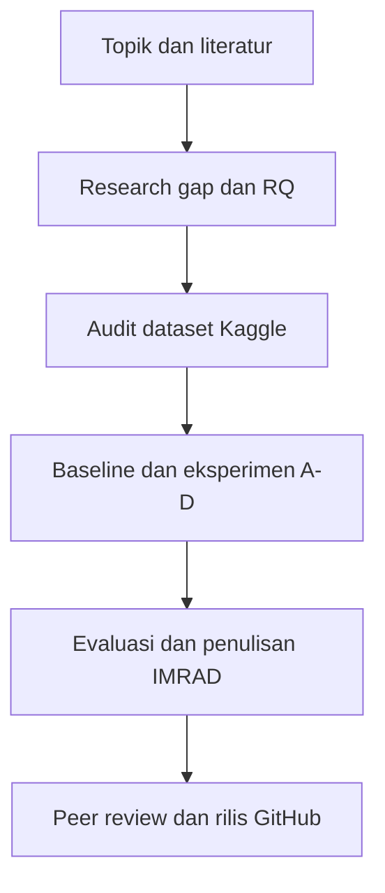

# ttki-phishing-detection

Proyek akhir Tata Tulis Karya Ilmiah (TTKI), Topik P1, Program Sarjana Terapan Teknik Informatika, PENS, Semester 5 (2026).

## Pertanyaan penelitian
Apakah selisih F1 dan ROC-AUC antara *random split* dan split per domain terdaftar (eTLD+1) pada PhiUSIIL bertahan setelah fitur yang tidak murni berasal dari URL dikeluarkan, dan berapa waktu inferensi total (ekstraksi fitur dan prediksi) pada tiap konfigurasi?

Posisi penelitian: replikasi kritis dan ablation, bukan klaim kebaruan. Studi terdekat sudah menjalankan perbandingan serupa pada fitur lengkap (lihat `references/literature_matrix.csv`).

## Alur


## Skenario
| | Split | Fitur |
|---|---|---|
| A | acak | semua (50) |
| B | acak | URL-only (18) |
| C | per eTLD+1 | URL-only (18) |
| D | per eTLD+1 | semua (50) |

Keputusan lengkap (label, duplikat, kelompok fitur, split, metrik): `docs/decisions.md`.

## Lingkungan
Python 3.11.9 pada Windows 11. Paket dan versi: `requirements.txt`.
```
python -m venv .venv
.venv\Scripts\activate
pip install -r requirements.txt
```

## Data
Lihat `data/README.md` (sumber, SHA-256, lisensi). CSV tidak disertakan.

## Urutan menjalankan
1. `python src/audit_data.py` menghasilkan `results/audit_summary.json`.
2. Notebook dan skrip eksperimen menyusul (`notebooks/`, `src/`).

## Status
Minggu 1 (literatur dan proposal) dan audit data awal selesai. Eksperimen belum dijalankan; belum ada hasil model.

## Atribusi
Dataset: Prasad dan Chandra (2024); lisensi dicatat di `data/README.md` setelah diverifikasi dari halaman Kaggle. Penggunaan asisten AI dilaporkan pada naskah dan proposal.
