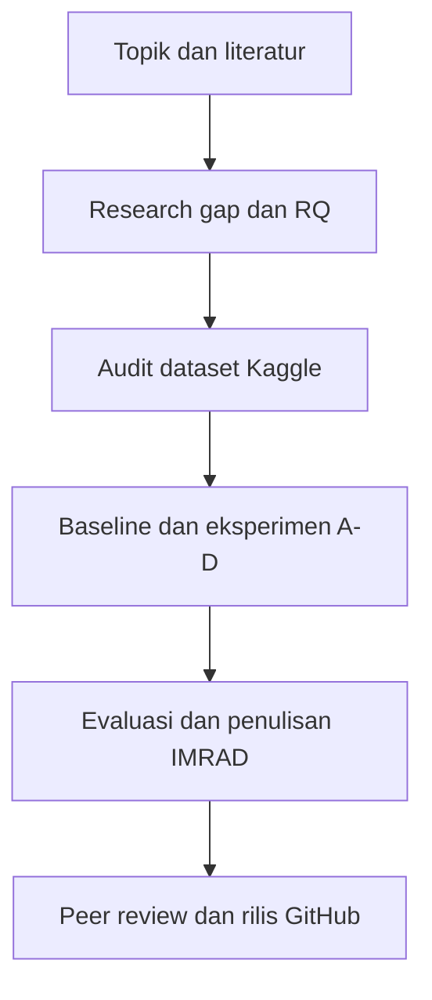

# ttki-phishing-detection

Proyek akhir Tata Tulis Karya Ilmiah (TTKI), Topik P1, Program Sarjana Terapan Teknik Informatika, PENS, Semester 5 (2026).

## Pertanyaan penelitian
Apakah selisih F1 antara pembagian acak dan pembagian per domain terdaftar (eTLD+1) pada PhiUSIIL bertahan setelah fitur yang tidak murni berasal dari URL dikeluarkan, dan berapa waktu inferensi total (ekstraksi fitur dan prediksi) pada tiap konfigurasi? ROC-AUC dilaporkan sebagai metrik pendukung di `results/metrics.csv`.

Posisi penelitian: replikasi kritis dan ablation, bukan klaim kebaruan. Studi terdekat sudah menjalankan perbandingan serupa pada fitur lengkap (lihat `references/literature_matrix.csv`).

## Alur


## Skenario
| | Split | Fitur |
|---|---|---|
| A | acak | semua (50) |
| B | acak | URL-only (18) |
| C | per eTLD+1 | URL-only (18) |
| D | per eTLD+1 | semua (50) |

Keputusan lengkap (label, duplikat, kelompok fitur, split, metrik): `docs/decisions.md`.

## Lingkungan
Python 3.11.9 pada Windows 11. Paket dan versi: `requirements.txt` (eksperimen) dan `environment-freeze.txt` (termasuk paket untuk notebook).
```
python -m venv .venv
.venv\Scriptsctivate
pip install -r requirements.txt
pip install nbformat nbconvert ipykernel    # hanya untuk menjalankan notebook
```
Skrip di `src/` saling mengimpor, jadi jalankan dari akar repositori dengan `PYTHONPATH=src` (PowerShell: `$env:PYTHONPATH = "src"`).

## Data
Lihat `data/README.md` (sumber, SHA-256, lisensi). CSV tidak disertakan; letakkan di `data/raw/`.

## Urutan menjalankan
1. `python src/audit_data.py` menghasilkan `results/audit_summary.json`.
2. `python src/check_splits.py` memeriksa pembagian data (`results/split_check.json`; split per grup memakan beberapa menit per seed dan di-cache di `data/interim/`).
3. `python src/run_experiments.py tuning`, lalu commit `results/config_beku.json`, lalu `python src/run_experiments.py final`. Fase `final` menolak berjalan bila konfigurasi belum di-commit.
4. `python src/analyze_results.py`, `python src/measure_latency.py`, dan `python src/make_figures.py` (selisih, waktu inferensi, gambar dan tabel).
5. Analisis post-hoc: `python src/run_ablation.py tuning|final`, `python src/analyze_ablation.py`, `python src/analyze_outlier.py`, `python src/reproduce_g1.py`.
6. `python src/build_paper.py` merakit `paper/draft.docx` dari berkas hasil.
7. Notebook di `notebooks/` membaca hasil yang sudah disimpan; pelatihan model dilakukan oleh skrip di atas.

## Status
Minggu 1 sampai 4 selesai: literatur dan proposal, audit data, eksperimen skenario A sampai D (hasil di `results/`), dan draf paper IMRAD (`paper/draft.docx`). Minggu 5 (peer review silang, respons reviewer, tag rilis) belum.

## Atribusi
Dataset: Prasad dan Chandra (2024); lisensi menurut UCI (CC BY 4.0) dan Kaggle (CC BY-SA 4.0) dicatat di `data/README.md`. Kode berlisensi MIT (`LICENSE`). Penggunaan asisten AI dilaporkan pada naskah dan proposal.
